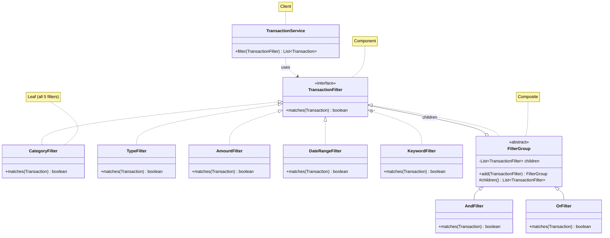
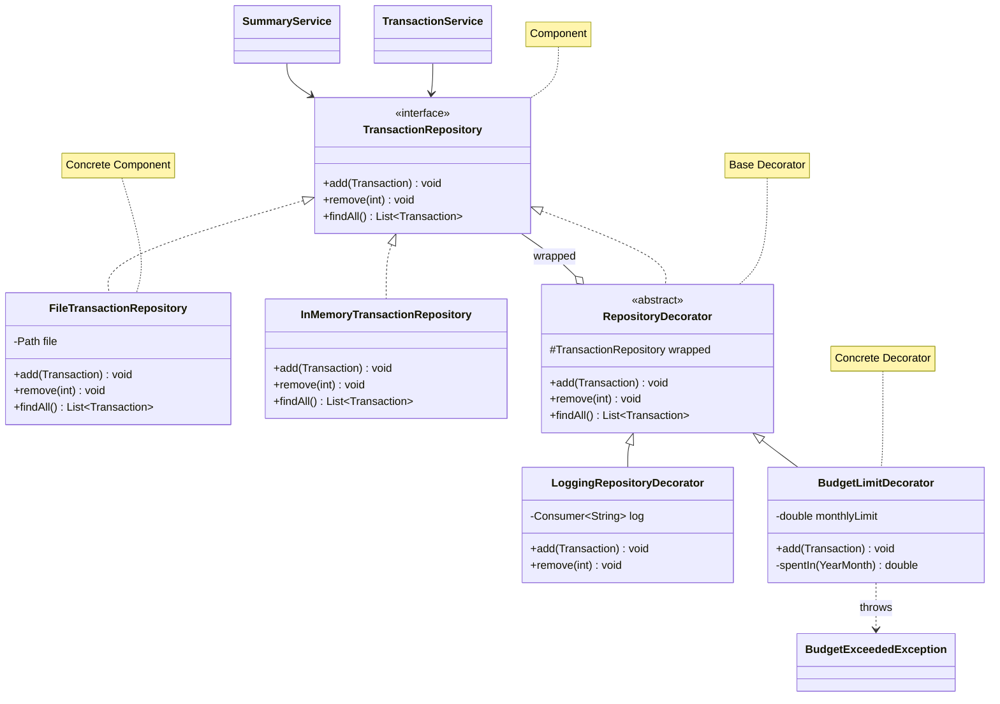
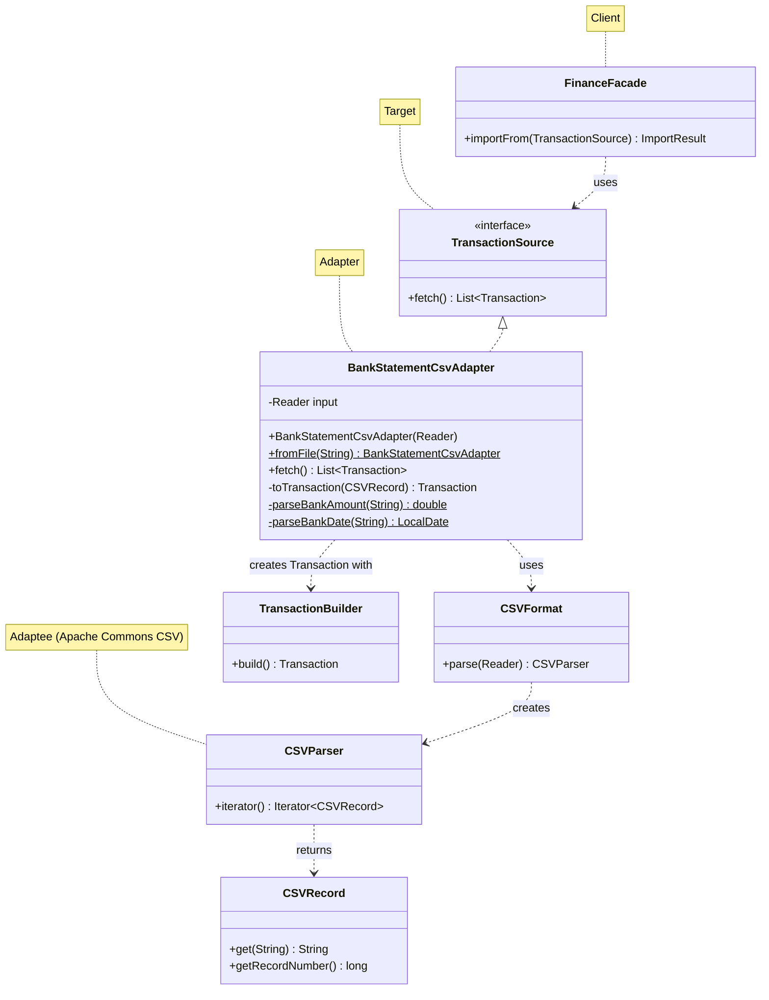
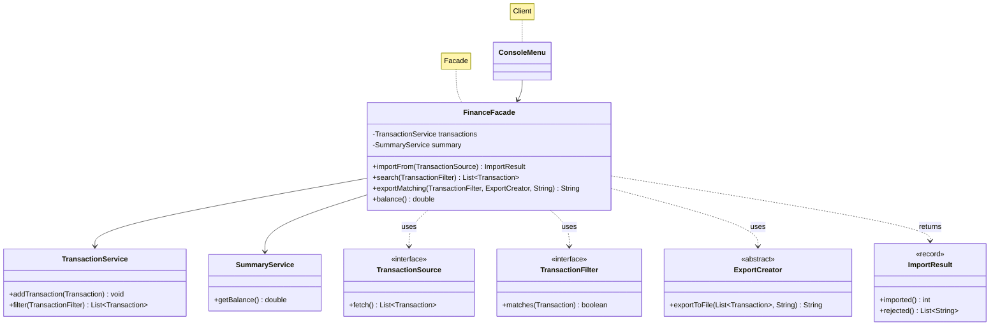
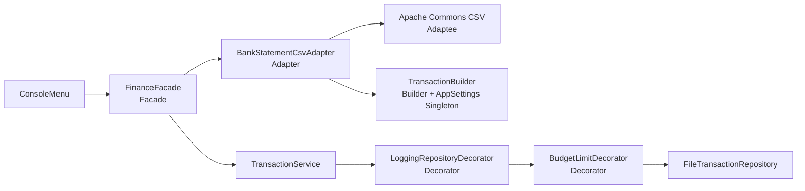

# Lab 3 - TMPS: Structural Design Patterns

Vasile Brînză, gr. FAF-242

## 1. Domain description

The project is a console finance tracker. The user adds incomes and expenses (amount, description,
category, date), sees the history, deletes transactions, sees a summary (total income, total expenses,
balance, expenses by category), filters the history and exports it to CSV or TXT. The data is saved in
`transactions.txt`.

In this lab I extended the same app from the creational patterns lab with four structural patterns.
Each one comes from something the app needed:

| Pattern | Where | Problem it solves in this app |
|---|---|---|
| Composite | `filter/composite` | combine filters (AND / OR, also nested) and still pass them as one filter |
| Decorator | `repository/decorator` | add logging and a monthly budget limit to the storage without changing it |
| Adapter | `importer/adapter` | import a bank statement read by Apache Commons CSV, a library I can't change |
| Facade | `facade` | one simple entry point for import, search and export, so the menu doesn't wire the subsystem |

The creational patterns from the previous lab are reused: the Adapter creates transactions with
`TransactionBuilder` (Builder), the default category comes from `AppSettings` (Singleton), and the
Facade exports through `ExportCreator` (Factory Method).

### Theory

Structural patterns are about how classes and objects are put together into bigger structures, while
the structure stays flexible. The seven classic ones are:

- **Adapter** - makes a class with an incompatible interface work with my code, by wrapping it in a
  class that implements the interface I expect.
- **Bridge** - separates an abstraction from its implementation so both can change independently
  (two hierarchies connected by a has-a link).
- **Composite** - lets the client treat a single object and a group of objects the same way, through
  one interface. Groups can contain other groups, so you get a tree.
- **Decorator** - adds behaviour to an object at runtime by wrapping it in another object with the same
  interface. Wrappers can be stacked in any combination.
- **Facade** - gives one simple interface to a complicated subsystem. It only delegates.
- **Flyweight** - shares the common (intrinsic) state between many small objects to save memory;
  the state that changes (extrinsic) is passed in from outside.
- **Proxy** - a stand-in with the same interface as the real object that controls access to it
  (permission checks, lazy loading, caching).

I did not use Bridge, Flyweight and Proxy. Bridge would need two independent hierarchies, and here the
export format is the only thing that varies (the destination is always a file). Flyweight would only
make sense with many thousands of objects sharing state, and the app has a few dozen transactions.
Proxy would fit as a PIN check before deleting, but it would look almost the same as my decorators,
so I chose Decorator because I wanted to add behaviour, not to control access.

### Project structure

```
expense-tracker/
├── pom.xml
├── src/
│   ├── app/          ConsoleMenu, Main               (client code)
│   ├── model/        Transaction, TransactionBuilder (domain)
│   ├── config/       AppSettings
│   ├── service/      TransactionService, SummaryService
│   ├── repository/   TransactionRepository + file / in-memory
│   │   └── decorator/    Decorator
│   ├── filter/       TransactionFilter + 5 filters
│   │   └── composite/    Composite
│   ├── importer/     TransactionSource
│   │   └── adapter/      Adapter
│   ├── facade/       Facade
│   └── export/       Factory Method (Lab 1)
└── test/
    └── StructuralPatternsTest.java
```

## 2. Patterns

### 2.1 Composite: filter groups

Before this lab the user could filter only by one thing at a time: category, or type, or date, and
so on. To find, for example, "expenses that are food or transport", I would need a new class for every
combination. With Composite, a group of filters is itself a `TransactionFilter`, so it can be passed
everywhere a single filter is accepted. Because a group can contain other groups, any AND / OR
expression can be built from the five filters I already had.

Roles: `TransactionFilter` is the Component, the five existing filters are Leaves, `FilterGroup` with
`AndFilter` and `OrFilter` is the Composite, and `TransactionService` / `FinanceFacade` are the clients.



Code ([FilterGroup.java](../expense-tracker/src/filter/composite/FilterGroup.java),
[AndFilter.java](../expense-tracker/src/filter/composite/AndFilter.java)):

```java
public abstract class FilterGroup implements TransactionFilter {
    private final List<TransactionFilter> children = new ArrayList<>();

    public FilterGroup add(TransactionFilter filter) {
        if (filter == null) {
            throw new IllegalArgumentException("Filter cannot be null.");
        }
        children.add(filter);
        return this;
    }
    // ...
}

public class AndFilter extends FilterGroup {
    @Override
    public boolean matches(Transaction transaction) {
        for (TransactionFilter child : children()) {
            if (!child.matches(transaction)) {
                return false;
            }
        }
        return true;
    }
}
```

`FilterGroup` implements the same `TransactionFilter` interface as the leaves and keeps a list of
`TransactionFilter`, not of leaves, so a child can be a leaf or another group. `AndFilter.matches()`
just asks its children, so the client never has to check with `instanceof` what it got.

In the menu, option 6 of "Filter transactions" builds a group, and choosing option 6 again inside it
makes a nested group. I also used it for export: "export all" is just an empty `AndFilter`, which
matches everything.

Tests:

| Test | What it checks |
|---|---|
| `composite_leafAndGroupWorkTheSameWay` | a single `CategoryFilter` and an `AndFilter` holding it are both used as `TransactionFilter` and give the same answer |
| `composite_groupsCanBeNested` | `EXPENSE AND (food OR transport)` accepts a food expense and rejects rent, so groups inside groups work |

### 2.2 Decorator: logging and budget limit on the repository

I wanted two extra things when a transaction is saved: a log line for every change, and a monthly
budget limit that refuses an expense if the month would go over it. I didn't want to put this into
`FileTransactionRepository`, because then the in-memory repository wouldn't have it, and saving to a
file has nothing to do with budgets. With Decorator, each extra behaviour is a wrapper with the same
`TransactionRepository` interface, so the services don't know they are there.

Roles: `TransactionRepository` is the Component, `FileTransactionRepository` and
`InMemoryTransactionRepository` are Concrete Components, `RepositoryDecorator` is the base Decorator,
and `LoggingRepositoryDecorator` and `BudgetLimitDecorator` are the Concrete Decorators.



Code ([BudgetLimitDecorator.java](../expense-tracker/src/repository/decorator/BudgetLimitDecorator.java),
[Main.java](../expense-tracker/src/app/Main.java)):

```java
@Override
public void add(Transaction transaction) {
    if (transaction.getType() == TransactionType.EXPENSE) {
        YearMonth month = YearMonth.from(transaction.getDate());
        double spent = spentIn(month);
        if (spent + transaction.getAmount() > monthlyLimit) {
            throw new BudgetExceededException(String.format(
                    "Budget exceeded for %s: limit %.2f, already spent %.2f, this expense %.2f.",
                    month, monthlyLimit, spent, transaction.getAmount()));
        }
    }
    super.add(transaction); // only reached when the check passed
}

// Main.java: the decorators are stacked only here
TransactionRepository repository =
        new LoggingRepositoryDecorator(
                new BudgetLimitDecorator(
                        new FileTransactionRepository("transactions.txt"), MONTHLY_BUDGET));
```

The decorator adds its check and then calls `super.add()`, which forwards the call to the wrapped
repository. Because every decorator is also a `TransactionRepository`, they can be stacked in any
order in `Main`, and `TransactionService` and `SummaryService` keep working with the interface only.

`BudgetExceededException` extends `IllegalArgumentException`, so the menu, which already catches that
exception, shows the budget message without any change. The logger gets a `Consumer<String>`, which
is `System.out::println` in the app and a list in the tests.

Tests:

| Test | What it checks |
|---|---|
| `decorator_budgetBlocksExpenseOverTheLimit` | with a limit of 1000, an expense of 600 is saved, the next one of 500 throws, and only one transaction is stored |
| `decorator_orderOfStackingDoesNotMatter` | Logging around Budget and Budget around Logging give the same result: one stored transaction, the second one rejected, and exactly one log line |

### 2.3 Adapter: importing a bank statement with Apache Commons CSV

Typing every transaction by hand is slow, so I added an import from a bank statement. The statement
is a CSV with `;` as the separator, dates like `03.11.2026`, amounts like `1 234,50` and two separate
columns, Debit (money out) and Credit (money in). To read it I used **Apache Commons CSV**, a
third-party library. Its classes (`CSVFormat`, `CSVParser`, `CSVRecord`) know nothing about my
`Transaction`, and I can't change them, so this is a real interface mismatch. (The CSV format is an
example I made for the lab; it is not copied from a real bank.)

My app wants a `TransactionSource` with one method, `fetch()`, that returns a list of transactions.
`BankStatementCsvAdapter` implements this interface and translates the library's records into
transactions.

Roles: `TransactionSource` is the Target, `BankStatementCsvAdapter` is the Adapter, the Apache
Commons CSV classes are the Adaptee, and `FinanceFacade` is the Client.



Code ([BankStatementCsvAdapter.java](../expense-tracker/src/importer/adapter/BankStatementCsvAdapter.java)):

```java
@Override
public List<Transaction> fetch() {
    List<Transaction> result = new ArrayList<>();
    try (CSVParser parser = BANK_FORMAT.parse(input)) {   // call into the adaptee
        for (CSVRecord row : parser) {
            result.add(toTransaction(row));                // translate its data into ours
        }
    } catch (IOException e) {
        throw new UncheckedIOException(e);
    }
    return result;
}

private Transaction toTransaction(CSVRecord row) {
    String debit = row.get(DEBIT);
    String credit = row.get(CREDIT);
    boolean isExpense = !debit.isBlank();
    String amountText = isExpense ? debit : credit;
    // ... check that there is an amount ...
    return new TransactionBuilder()
            .type(isExpense ? TransactionType.EXPENSE : TransactionType.INCOME)
            .amount(parseBankAmount(amountText))
            .description(row.get(DETAILS))
            .date(parseBankDate(row.get(DATE)))
            .build();
}
```

`fetch()` is the method my app expects. Inside it, the adapter calls the library (`BANK_FORMAT.parse`)
and turns every `CSVRecord` into a `Transaction`: the Debit / Credit columns become the type,
`1 234,50` becomes `1234.5`, and `dd.MM.yyyy` becomes a `LocalDate`. The bank has no category, so the
Builder from the previous lab fills in the default category from `AppSettings`.

The adapter takes a `Reader`, so the tests pass a `StringReader` and the app passes a file
(`BankStatementCsvAdapter.fromFile(...)`). The sample file is `samples/bank-statement.csv`.

Tests:

| Test | What it checks |
|---|---|
| `adapter_translatesBankRowToTransaction` | the row `03.11.2026;Darwin;1 234,50;` becomes an EXPENSE of 1234.50 on 3 Nov 2026 with the description "Darwin" |
| `adapter_creditColumnBecomesIncome` | a value in the Credit column (`18 000,00`) becomes an INCOME of 18000.00 |

### 2.4 Facade: FinanceFacade

Importing a statement involves several classes: read the source, add every transaction through the
service (which goes through the decorators), and collect the transactions that were refused. Exporting
a filtered list means filtering through the service and then calling an export creator. Without a
facade the menu would have to know all of these steps. `FinanceFacade` gives one method for each use
case and only delegates to the subsystem. It doesn't calculate or store anything itself.

Roles: `FinanceFacade` is the Facade, `ConsoleMenu` is the Client, and `TransactionService`,
`SummaryService`, `TransactionSource`, `TransactionFilter` and `ExportCreator` are the subsystem.



Code ([FinanceFacade.java](../expense-tracker/src/facade/FinanceFacade.java)):

```java
// source (Adapter) -> service -> repository (Decorators)
public ImportResult importFrom(TransactionSource source) {
    int imported = 0;
    List<String> rejected = new ArrayList<>();
    for (Transaction t : source.fetch()) {
        try {
            transactions.addTransaction(t);
            imported++;
        } catch (IllegalArgumentException e) {
            rejected.add(t.getDescription() + ": " + e.getMessage());
        }
    }
    return new ImportResult(imported, List.copyOf(rejected));
}

// Composite filter -> Factory Method export (Lab 1)
public String exportMatching(TransactionFilter filter, ExportCreator creator, String baseName) {
    return creator.exportToFile(transactions.filter(filter), baseName);
}
```

Each method is a short sequence of calls to the subsystem: `importFrom` asks the source for the
transactions and gives each one to the service, and `exportMatching` filters through the service and
passes the result to the export creator. The facade works only with interfaces and abstract classes
(`TransactionSource`, `TransactionFilter`, `ExportCreator`), so a new bank format, filter or export
format doesn't change it.

Tests:

| Test | What it checks |
|---|---|
| `facade_importSavesTransactionsFromTheSource` | with a stub `TransactionSource` (a lambda) returning two transactions, the facade reports 2 imported and both are stored in the repository |
| `facade_reportsRejectedTransactionsInsteadOfCrashing` | through the full path Facade -> Service -> `BudgetLimitDecorator` -> repository, the expense over the limit is counted as rejected, and the import doesn't stop |

## 3. How the patterns work together

The patterns are not separate demos. When the user imports a bank statement (menu option 8), one call
goes through four structural patterns and two creational ones:



Export of a filtered list (menu option 6, "only filtered") goes through
`ConsoleMenu -> FinanceFacade -> AndFilter / OrFilter (Composite) -> ExportCreator (Factory Method)`.

Every class in these paths works with an interface or an abstract class: the facade gets a
`TransactionSource`, the service gets a `TransactionRepository` and a `TransactionFilter`, and the export
gets an `ExportCreator`. The only place where concrete classes are chosen is `Main` (the decorators)
and the menu (which filter, which export format, which file to import).

### Open for extension

New variants are added by writing new classes only:

- a new filter group, e.g. `NotFilter extends FilterGroup`, is 1 new class;
- a new decorator, e.g. one that refuses a single expense above some amount, is 1 new class plus
  1 line in `Main`;
- a new bank format is a new class implementing `TransactionSource`, and the facade doesn't change.

## 4. Running and test results

From the repository root:

```
mvn -f expense-tracker/pom.xml test                  # run the unit tests
mvn -f expense-tracker/pom.xml -q compile exec:java  # run the app
```

To see all patterns in the app: import `samples/bank-statement.csv` with option 8 (the `[LOG]` lines
show the Decorator, and the laptop row is refused by the budget limit), then use option 5 -> 6 to build
an AND / OR filter.

All 8 tests are in [StructuralPatternsTest.java](../expense-tracker/test/StructuralPatternsTest.java).

Test log:

```
<!-- paste here the end of the "mvn test" output, the part with
     "Tests run: 8, Failures: 0, Errors: 0, Skipped: 0" and BUILD SUCCESS,
     or replace this block with a screenshot of the IntelliJ test runner -->
```

## 5. Conclusions

The four patterns each fixed a small real problem in the app. Composite let me combine the filters I
already had instead of writing a class for every combination. Decorator added logging and a budget limit
without touching the repositories or the services. Adapter let me use a library that knows nothing about
my classes, and Facade made import and export one call each for the menu.

What was harder than expected:

- Decorator and Composite look very similar in code: both implement the interface and keep a reference to
  it. The difference is in the intent. A decorator wraps one object and adds behaviour, while a
  composite holds many children and combines their answers. Proxy also looks the same as Decorator, so
  I had to think about why my wrappers are decorators (they add behaviour) and not proxies (they would
  control access).
- Deciding where the budget check should live. In the service it would be mixed with the other logic,
  and in the file repository it would be lost when I use the in-memory one. As a decorator it can be
  added or removed in `Main` only.
- The adapter had more small details than I expected: comma decimals, spaces in numbers, a different
  date format, and two columns for one amount.
- The project was a plain IntelliJ project, so to use a third-party library and run tests with one
  command I had to move it to Maven.

What I would design differently:

- The menu still uses the services directly for adding, deleting and the summary. I would move those
  calls behind the facade too, so the menu depends only on `FinanceFacade`.
- The budget limit is a constant in `Main`. It would be better in `AppSettings`, editable from the
  Settings menu.
- The facade catches every `IllegalArgumentException` during import. Catching only
  `BudgetExceededException` would make it clearer which errors count as "rejected".
- The adapter can be read only once, because it holds a `Reader`. Keeping the file path and opening the
  file inside `fetch()` would allow importing the same source again.
