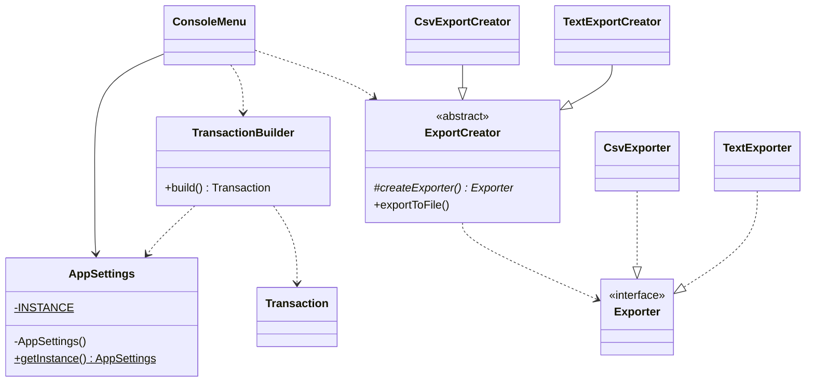

# Lab 2 - TMPS

Vasile Brînză, gr. FAF-242

In this lab I took the finance tracker from Lab 1 and added creational design patterns to it. I picked
three of them: Singleton, Builder and Factory Method. I chose these because they seemed the easiest
to understand, and because each one fit into something the app already needed. While doing this I also
made the app more useful: it now saves the data to a file, it can export the history, there are two
new filters and a settings menu. At the end I put the classes into packages because the project
was getting messy.

## Theory

Design patterns are ready-made solutions to problems that developers meet again and again when
writing code. They are not finished code that you copy, but a general idea of how to organize classes
so that the code is easier to read, change and extend. Creational patterns, the ones from this lab,
are about how objects are created.

Singleton makes sure a class has only one instance in the whole app, and gives everybody the same
access point to it. I use it for `AppSettings`, so the currency and default category are the same
everywhere.

Builder creates a complex object step by step, with named values and defaults, instead of one
long constructor call. I use it for `Transaction`, so I don't have to remember the order of its 5
parameters.

Factory Method lets a parent class use an object without knowing its exact class, because the
subclasses decide what to create. I use it for exporting, so adding a new file format means adding
new classes, not editing old ones.


## 1. Singleton: AppSettings

The app has some settings, the currency and the default category. They have to be the same
everywhere, so if I change the currency in the settings menu, the summary and the history must show
the new one too. If every class made its own settings object, that would not work, because each one
would have its own copy.

The Singleton pattern solves this by making sure the class has only one instance. I made the constructor
`private`, so nobody can write `new AppSettings()`. The one instance is stored in a static field, and
everybody gets it by calling `AppSettings.getInstance()`.

```java
public class AppSettings {
    // the only instance, created once
    private static final AppSettings INSTANCE = new AppSettings();

    private String currency = "MDL";
    private String defaultCategory = "general";
    
    private AppSettings() {}

    public static AppSettings getInstance() {
        return INSTANCE;
    }

    public String getCurrency() { return currency; }
    public void setCurrency(String currency) {
        if (currency == null || currency.isBlank())
            throw new IllegalArgumentException("Currency cannot be empty.");
        this.currency = currency.trim().toUpperCase();
    }
}
```

In `ConsoleMenu` I just take the instance once and use it when printing:

```java
private final AppSettings settings = AppSettings.getInstance();
```

Now when I change the currency to EUR in the Settings menu, the title of the menu, the history and the
summary all show EUR. `TransactionBuilder` also uses the same object to get the default category. I
used the simplest kind of Singleton (the object is created when the class loads). It is not
thread-safe in a fancy way, but this is a console app with one thread, so it is enough.

## 2. Builder: TransactionBuilder

Before, adding a transaction looked like this:

```java
new Transaction(amount, description, type, date, category);
```

It works, but it is easy to put the arguments in the wrong order, especially because amount is a
number and the others are mostly strings. Also, the category and the date are optional (empty category
means the default one, empty date means today), so the menu had to handle those defaults by itself.

With the Builder I can write the name of every value, and the defaults live inside the builder. Each
setter returns `this`, so I can chain the calls.

```java
public class TransactionBuilder {
    private double amount;
    private String description;
    private TransactionType type;
    // defaults for the optional fields
    private LocalDate date = LocalDate.now();
    private String category = AppSettings.getInstance().getDefaultCategory();

    public TransactionBuilder amount(double amount) { this.amount = amount; return this; }
    // description() and type() are the same

    public TransactionBuilder category(String category) {
        if (category != null && !category.isBlank()) this.category = category; // empty keeps default
        return this;
    }
    // date() works like category(), null keeps today

    public Transaction build() {
        return new Transaction(amount, description, type, date, category);
    }
}
```

And in the menu:

```java
Transaction t = new TransactionBuilder()
        .type(type)
        .amount(amount)
        .description(description)
        .category(category)
        .date(dateText.isBlank() ? null : parseDate(dateText))
        .build();
```

I did not change the `Transaction` class at all. The builder just collects the values and then calls its
constructor, so the validation (positive amount, description not empty) still happens there. The
result is that the code in the menu is easier to read and the defaults are in one place.

## 3. Factory Method: exporting

I wanted to export the history to a file, in CSV (to open in Excel) and in a simple TXT report.
The easy way would be an `if/else` in the menu that builds the text for each format, but then every new
format would mean changing old code.

With Factory Method, there is an abstract class `ExportCreator` that does the part which is the same for
all formats (create the file name and write the file). It does not know which exporter to use, so it
calls an abstract method `createExporter()`. This is the factory method. The subclasses
`CsvExportCreator` and `TextExportCreator` implement it and return the exporter they want. The
exporters themselves implement the `Exporter` interface, which has two methods: `format(...)` (makes
the text) and `extension()` (gives "csv" or "txt").

```java
public abstract class ExportCreator {

    // the factory method: subclasses decide what to create
    protected abstract Exporter createExporter();

    public String exportToFile(List<Transaction> list, String baseName) {
        Exporter exporter = createExporter();
        String fileName = baseName + "." + exporter.extension();
        try {
            Files.writeString(Path.of(fileName), exporter.format(list));
        } catch (IOException e) {
            throw new UncheckedIOException(e);
        }
        return fileName;
    }
}

public class CsvExportCreator extends ExportCreator {
    protected Exporter createExporter() { return new CsvExporter(); }
}
```

The menu only picks which creator to use and calls `exportToFile`:

```java
ExportCreator creator = switch (choice) {
    case "1" -> new CsvExportCreator();
    case "2" -> new TextExportCreator();
    default -> throw new IllegalArgumentException("Unknown format.");
};
String file = creator.exportToFile(transactionService.getTransactions(), "export");
```

If I want a JSON export later, I only write a `JsonExporter` and a `JsonExportCreator`, and I do not
touch `ExportCreator`. In the CSV exporter I put the description in quotes, because a description can
contain commas and that would break the columns.

## Diagram



The diagram shows how the three patterns connect to the app, starting from `ConsoleMenu`, which uses all
of them. `AppSettings` is the Singleton: the menu uses its one instance, and `TransactionBuilder`
also reads the default category from it. The `TransactionBuilder` (Builder) collects the values
and builds a `Transaction`. For exporting, the menu picks an `ExportCreator` (Factory Method).
`CsvExportCreator` and `TextExportCreator` extend it, and each one creates its own exporter,
`CsvExporter` or `TextExporter`, which both implement the `Exporter` interface.

## Conclusion

The three patterns each solved a small real problem in the app. Singleton gave me one settings object
for the whole app, Builder made the creation of a transaction easier to read, and Factory Method
made it easy to add new export formats. The most useful part for me was seeing how the
interfaces from Lab 1 helped: adding the file storage and the new filters did not require changes in
the existing services. There are some limits: the currency is only a label (the amounts are not
converted), and the settings are not saved, so they go back to the defaults when the app restarts.