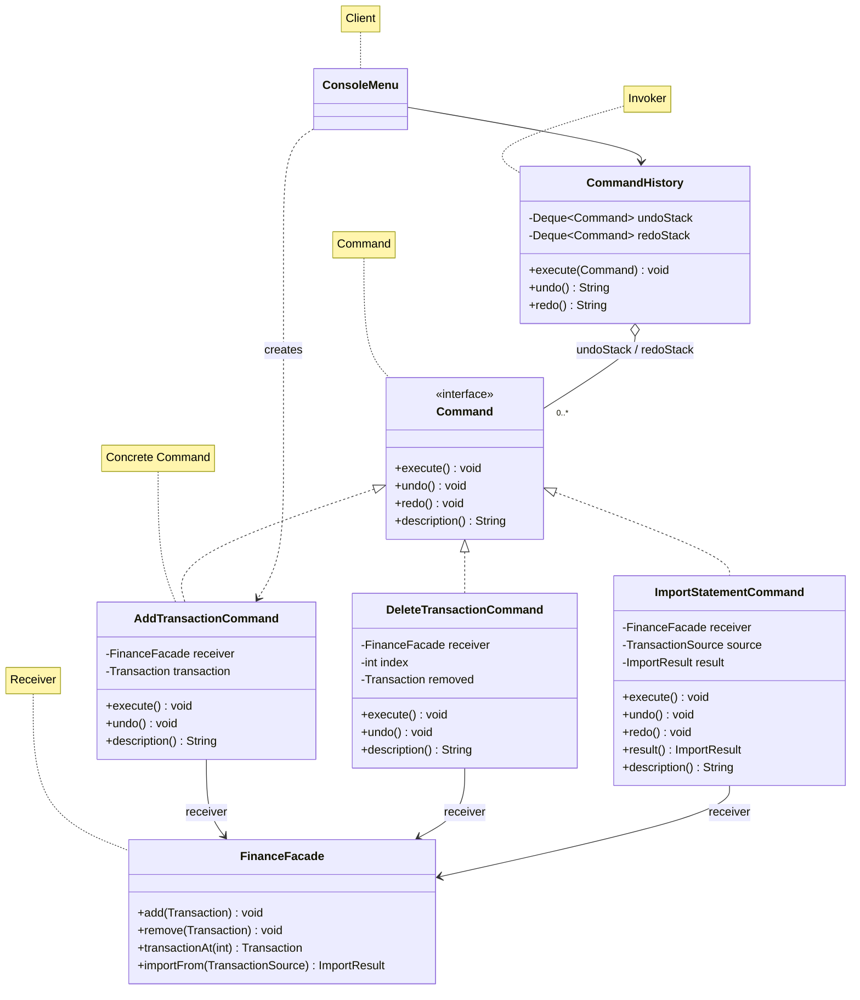
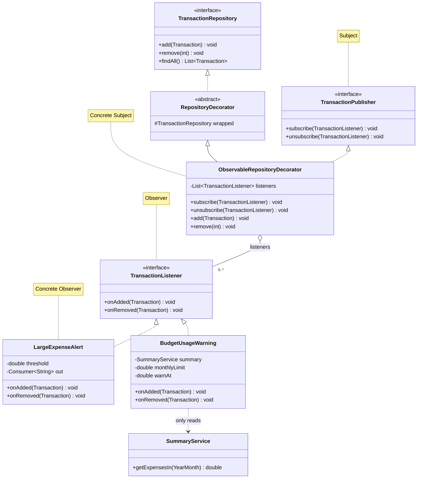
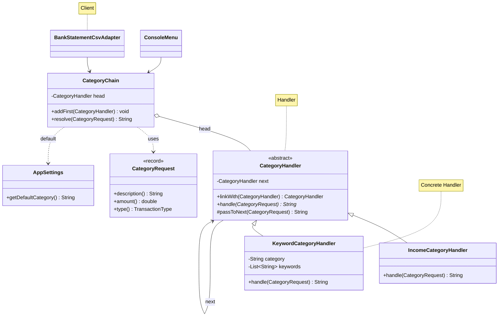
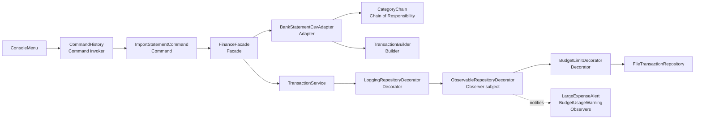

# Lab 3 - TMPS: Behavioral Design Patterns

Vasile Brînză, gr. FAF-242

## 1. Domain description

The project is a console finance tracker. The user adds incomes and expenses (amount, description,
category, date), sees the history, deletes transactions, sees a summary (total income, total expenses,
balance, expenses by category), filters the history, exports it to CSV or TXT and imports a bank
statement. The data is saved in `transactions.txt`.

In this lab I extended the same app (creational patterns in Lab 1, structural patterns in Lab 2) with
three behavioral patterns. Each one comes from something the app was missing:

| Pattern | Where | Problem it solves in this app |
|---|---|---|
| Command | `command` | a wrong add, delete or import could not be taken back; now there is Undo / Redo |
| Observer | `observer` | nobody warned the user about a large expense or about being close to the monthly budget |
| Chain of Responsibility | `categorization` | imported bank rows have no category, so everything was "general"; now a chain of rules chooses it |

They are built on the previous labs, not next to them:

- the Observer subject (`ObservableRepositoryDecorator`) is one more **Decorator** around the repository;
- the commands use the **Facade** (`FinanceFacade`) as their receiver, and an import command runs the
  **Adapter** (`BankStatementCsvAdapter`);
- the chain is given to the Adapter, so the transactions it creates through the **Builder** get a category;
- the default category when nobody in the chain knows comes from the **Singleton** `AppSettings`.

### Theory

Behavioral patterns are about how objects communicate and how responsibilities are shared between
them, so that the behaviour can be changed or extended without rewriting the existing classes.

- **Chain of Responsibility** - passes a request along a chain of handlers until one of them handles it.
  The sender doesn't know which handler will do it.
- **Command** - turns a request into an object, so it can be stored, queued, logged and undone.
- **Interpreter** - defines a small grammar and a way to evaluate sentences of it (good to know, it is
  not one of the three).
- **Iterator** - goes through a collection without showing how it is stored inside.
- **Mediator** - objects talk through one central mediator and don't refer to each other.
- **Memento** - saves and restores the state of an object without breaking its encapsulation.
- **Observer** - when the subject changes, all the objects subscribed to it are notified automatically.
- **State** - an object changes its behaviour when its internal state changes (state classes with
  transitions between them).
- **Strategy** - a family of interchangeable algorithms, one of them chosen at runtime.
- **Template Method** - the skeleton of an algorithm is in a base class, subclasses override some steps.
- **Visitor** - adds a new operation to a structure of objects without changing their classes (double
  dispatch with `accept` / `visit`).

I did not use the other patterns because I could not find a place for them in this app that wasn't
forced. Memento would be a natural choice for undo, but my commands already know what they must
reverse (the added or removed transactions), so saving a full snapshot would be more than needed.
Strategy would fit sorting the history, and Template Method would repeat what the export already does
with Factory Method. State, Mediator and Visitor would need something that the app doesn't have
(an object with several modes, many objects that talk to each other, or a class hierarchy to
traverse), and the Iterator in Java is already in the collections.

### Project structure

```
expense-tracker/
├── pom.xml
├── src/
│   ├── app/            ConsoleMenu, Main                  (client code)
│   ├── model/          Transaction, TransactionBuilder    (domain)
│   ├── config/         AppSettings
│   ├── service/        TransactionService, SummaryService
│   ├── repository/     TransactionRepository + file / in-memory
│   │   └── decorator/      Decorator (lab 2)
│   ├── filter/         TransactionFilter + filters
│   │   └── composite/      Composite (lab 2)
│   ├── importer/       TransactionSource
│   │   └── adapter/        Adapter (lab 2)
│   ├── facade/         Facade (lab 2)
│   ├── export/         Factory Method (lab 1)
│   ├── command/        Command            <- lab 3
│   ├── observer/       Observer           <- lab 3
│   └── categorization/ Chain of Responsibility  <- lab 3
└── test/
    ├── StructuralPatternsTest.java
    └── BehavioralPatternsTest.java
```

## 2. Patterns

### 2.1 Command: undo and redo

Before this lab, a wrong transaction could only be fixed by hand. The worst case was an import: one
mistake and the user had to delete every imported row one by one. With Command, every action that
changes the data is an object with `execute()` and `undo()`, and a history keeps them in two stacks.

Roles: `Command` is the Command interface, `AddTransactionCommand`, `DeleteTransactionCommand` and
`ImportStatementCommand` are the Concrete Commands, `FinanceFacade` is the Receiver, `CommandHistory`
is the Invoker and `ConsoleMenu` is the Client.



Code ([CommandHistory.java](../expense-tracker/src/command/CommandHistory.java),
[ImportStatementCommand.java](../expense-tracker/src/command/ImportStatementCommand.java)):

```java
// INVOKER: runs commands and keeps the history
public class CommandHistory {
    private final Deque<Command> undoStack = new ArrayDeque<>();
    private final Deque<Command> redoStack = new ArrayDeque<>();

    public void execute(Command command) {
        command.execute();          // if it throws (e.g. budget), it never enters the history
        undoStack.push(command);
        redoStack.clear();
    }

    public String undo() {
        if (undoStack.isEmpty()) throw new IllegalArgumentException("Nothing to undo.");
        Command c = undoStack.pop();
        c.undo();
        redoStack.push(c);
        return c.description();
    }
}

public class ImportStatementCommand implements Command {
    @Override public void execute() { result = receiver.importFrom(source); }

    @Override
    public void undo() {
        for (Transaction t : result.added()) receiver.remove(t);
    }
}
```

`CommandHistory` only works with the `Command` interface, so it doesn't know what a command does. A
command is added to the history only after `execute()` finished without an exception, so an action
refused by the budget cannot be undone by mistake. The commands keep what they need to reverse
themselves: the delete command remembers the removed transaction, and the import command remembers
the list of transactions that were really added (`ImportResult.added()`), so Undo removes the whole
import with one step. The business logic stays in the receiver (`FinanceFacade`).

In the menu, "9. Undo" and "10. Redo" call the history. Known limits: a deleted transaction is brought
back at the end of the list, not at its old position, and the history is not saved when the app closes.

Tests:

| Test | What it checks |
|---|---|
| `command_undoAddRemovesTheTransaction` | after `AddTransactionCommand` the repository has 1 transaction, after `undo()` it is empty |
| `command_undoDeleteBringsTheTransactionBack` | after `DeleteTransactionCommand` the list is empty, after `undo()` the same object is back |
| `command_redoAfterUndoDoesItAgain` | execute, undo, redo gives the transaction again |
| `command_refusedCommandIsNotAddedToHistory` | an expense refused by the budget throws and doesn't enter the history, so `undo()` removes the previous one and the next `undo()` says there is nothing to undo |
| `command_undoImportRemovesEverythingThatWasImported` | an import of 2 transactions (with a stub source) is fully removed by one `undo()` |

### 2.2 Observer: budget alerts

The app already refused expenses over the monthly budget (the `BudgetLimitDecorator` from Lab 2), but it
never warned the user before that point, or about a big purchase. I didn't want to put this
into the repository or into the menu code. With Observer, the repository publishes "a transaction was
added / removed", and any number of listeners can subscribe to hear it.

Roles: `TransactionPublisher` is the Subject interface, `ObservableRepositoryDecorator` is the Concrete
Subject, `TransactionListener` is the Observer interface, and `LargeExpenseAlert` and
`BudgetUsageWarning` are the Concrete Observers.



Code ([ObservableRepositoryDecorator.java](../expense-tracker/src/observer/ObservableRepositoryDecorator.java),
[LargeExpenseAlert.java](../expense-tracker/src/observer/LargeExpenseAlert.java)):

```java
public class ObservableRepositoryDecorator extends RepositoryDecorator implements TransactionPublisher {
    private final List<TransactionListener> listeners = new ArrayList<>();

    @Override public void subscribe(TransactionListener l) { if (!listeners.contains(l)) listeners.add(l); }
    @Override public void unsubscribe(TransactionListener l) { listeners.remove(l); }

    @Override
    public void add(Transaction t) {
        super.add(t);                                    // if the budget refuses, nobody is notified
        for (TransactionListener l : List.copyOf(listeners)) l.onAdded(t);
    }
}

public class LargeExpenseAlert implements TransactionListener {
    @Override
    public void onAdded(Transaction t) {
        if (t.getType() == TransactionType.EXPENSE && t.getAmount() >= threshold) {
            out.accept("[ALERT] Large expense: " + t.getAmount() + " for " + t.getDescription());
        }
    }
    // ...
}
```

The subject keeps a list of `TransactionListener` (the interface, not the concrete alerts) and notifies
it only after `super.add()` succeeded, so an expense that was refused by a decorator below it is never
announced. The loop goes over a copy of the list, so a listener can unsubscribe while being notified.
The subject itself is a decorator, so it is placed in `Main` like the other two, and the rest of the app
still sees a `TransactionRepository`.

The listeners only read (`BudgetUsageWarning` calls `SummaryService`, it doesn't write), so a
notification cannot cause another notification in an endless loop. The listeners get a `Consumer<String>`
for the output, which is `System.out::println` in the app and a list in the tests.

At runtime, "7. Settings -> 4" subscribes or unsubscribes both alerts.

Tests:

| Test | What it checks |
|---|---|
| `observer_subscribedListenerIsNotifiedUnsubscribedIsNot` | a listener hears the first add, and after `unsubscribe` it doesn't hear the second one |
| `observer_refusedExpenseNotifiesNobody` | with a budget decorator inside, an expense that is refused produces no notification |
| `observer_largeExpenseAlertOnlyAboveThreshold` | an expense of 50 gives no alert, an expense of 15000 gives exactly one (threshold 3000) |
| `observer_budgetWarningAppearsAt80Percent` | with a limit of 1000, 500 spent gives no warning, 900 spent gives one |

### 2.3 Chain of Responsibility: choosing the category

A bank statement has no category column. After the Lab 2 import everything got the default category,
and the summary by category was useless. Adding an `if / else if` list with all the shops inside the
adapter would mean changing it every time there is a new rule. With a chain, every rule is a small
handler that either decides the category or passes the request to the next one.

Roles: `CategoryHandler` is the Handler, `IncomeCategoryHandler` and `KeywordCategoryHandler` are the
Concrete Handlers, `CategoryRequest` is the request, and `CategoryChain` is the entry point for the
client (`BankStatementCsvAdapter` and `ConsoleMenu`).



Code ([CategoryHandler.java](../expense-tracker/src/categorization/CategoryHandler.java),
[KeywordCategoryHandler.java](../expense-tracker/src/categorization/KeywordCategoryHandler.java),
[CategoryChain.java](../expense-tracker/src/categorization/CategoryChain.java)):

```java
public abstract class CategoryHandler {
    private CategoryHandler next;

    public CategoryHandler linkWith(CategoryHandler next) {
        this.next = next;
        return next;            // lets you write a.linkWith(b).linkWith(c)
    }

    public abstract String handle(CategoryRequest request);

    protected String passToNext(CategoryRequest request) {
        return next == null ? null : next.handle(request);   // null = "nobody knew"
    }
}

public class KeywordCategoryHandler extends CategoryHandler {
    @Override
    public String handle(CategoryRequest request) {
        String text = request.description().toLowerCase();
        for (String k : keywords) {
            if (text.contains(k.toLowerCase())) return category;
        }
        return passToNext(request);
    }
}

public class CategoryChain {
    public String resolve(CategoryRequest request) {
        String category = head == null ? null : head.handle(request);
        return category != null ? category : AppSettings.getInstance().getDefaultCategory();
    }
}
```

A handler either returns a category or calls `passToNext()`, so the first one that knows the answer wins.
The chain is built in `Main`, not inside the handlers:

```java
head.linkWith(new KeywordCategoryHandler("food", "linella", "kaufland", "nr1", "fourchette"))
    .linkWith(new KeywordCategoryHandler("transport", "taxi", "yandex", "bolt", "trolleybus"))
    // ...
```

The client doesn't call the handlers directly, it calls `CategoryChain.resolve()`, and that method
never lets a request fall off the end: if no handler knows the category, the default one from
`AppSettings` is returned.

The chain is changed at runtime: "7. Settings -> 3" calls `categories.addFirst(...)` with a new keyword
rule, and this rule is checked before all the others. The same chain is used when a transaction is
added by hand with an empty category, and when a statement is imported.

Tests:

| Test | What it checks |
|---|---|
| `chain_matchingHandlerGivesTheCategory` | "Linella Botanica" gives `food` and "Taxi home" gives `transport` |
| `chain_unhandledRequestEndsWithDefaultCategory` | a description that no handler knows gives the default category, it doesn't end with `null` |
| `chain_firstHandlerThatKnowsWins` | an income that contains "linella" is `income`, because the income handler is first |
| `chain_ruleAddedAtRuntimeIsCheckedFirst` | after `addFirst`, a new rule for "linella" wins over the old `food` rule |

## 3. How the patterns work together

The patterns are not separate demos. When the user imports a bank statement (menu option 8), one
action passes through three behavioral patterns, three structural ones and two creational ones:



What happens, step by step: the menu gives the command to the history, which runs it. The command asks
the facade to import. The adapter reads the CSV with Apache Commons CSV, asks the chain for the
category of each row, and builds the transactions with the Builder. For each of them the service calls the
repository, which goes through the logging decorator, then the observable decorator, then the budget
check, and is saved in the file. If it was really saved, the observers are notified. If the budget refuses a
row, it is counted as rejected and nobody is notified. Then "9. Undo" runs the same path backwards:
the command removes the transactions it added, and the observers hear `onRemoved` for each one.

Every class in the path works with an interface or an abstract class: the history with `Command`, the
command with the facade and a `TransactionSource`, the subject with `TransactionListener`, the adapter
with `CategoryChain`. The concrete classes are chosen only in `Main` (decorators, observers, the chain
order) and in the menu (which command to create).

### Behavior changes while the app is running

| What the user does | What changes |
|---|---|
| Settings -> add category rule | a new handler is put at the head of the chain |
| Settings -> alerts off / on | the two observers are unsubscribed / subscribed |
| Undo / Redo | commands move between the two stacks |

### Open for extension

New variants are new classes only:

- a new command, e.g. `EditTransactionCommand`, is 1 new class and 1 line in the menu;
- a new observer, e.g. a reminder for the rent, is 1 new class and 1 line in `Main`
  (`observable.subscribe(...)`);
- a new rule type, e.g. `AmountCategoryHandler` (an expense of 5000 or more is a "big purchase"), is 1 new
  class and 1 line in `Main`, and `CategoryChain` and the other handlers don't change.

## 4. Running and test results

From the repository root:

```
mvn -f expense-tracker/pom.xml test                  # run the unit tests
mvn -f expense-tracker/pom.xml -q compile exec:java  # run the app
```

To see the patterns in the app:

1. Import `samples/bank-statement.csv` with option 8. The `[LOG]` lines show the Decorator, the imported
   rows get categories (food, rent, ...) from the chain, the large expense gives an `[ALERT]` and the
   budget usage gives a `[WARNING]`, and the laptop row is refused by the budget limit.
2. Press option 9 (Undo): the whole import disappears. Press option 10 (Redo): it comes back.
3. Settings -> 4 turns the alerts off, then add an expense: no alert is shown.
4. Settings -> 3 adds a rule (e.g. "darwin" -> "tech"). A new expense with this word gets the new category.

The new tests are in [BehavioralPatternsTest.java](../expense-tracker/test/BehavioralPatternsTest.java):
13 tests for the three patterns, plus 1 test (`importGoesThroughCommandAdapterChainAndObserver`) that checks
the path through all of them together. The 8 tests from the previous lab still pass.

Test log:

```
<!-- paste here the end of the "mvn test" output, the part with
     "Tests run: 22, Failures: 0, Errors: 0, Skipped: 0" and BUILD SUCCESS,
     or replace this block with a screenshot of the IntelliJ test runner -->
```

## 5. Conclusions

The three patterns each solved a problem the app really had. Command gave Undo and Redo, and an import
can be taken back in one step. Observer made the budget alerts possible without the repository or the
menu knowing anything about them. Chain of Responsibility replaced a big list of shop names with small
rules that can be added at runtime. They also fit the earlier labs well: the subject is a decorator,
the commands call the facade, and the chain is used by the adapter.

What was harder than expected:

- Undo is only simple for an add. For a delete I had to decide what "back" means (the transaction returns
  at the end of the list, not at its old position), and for an import I had to change `ImportResult`
  so it keeps the list of added transactions, because the count was not enough to undo it.
- Deciding when the observers are told. If the notification is sent before the save, a transaction
  refused by the budget would still produce an alert, so the subject notifies only after
  `super.add()` succeeded. The order of the decorators in `Main` matters here: the observable
  decorator must be above the budget one.
- The chain is easy to break in two ways: a request can fall off the end and return `null`, and the order
  of the handlers changes the result. I solved the first with the default category in `CategoryChain`,
  and the second by building the order in `Main` only.
- Observer and Command both look like "just a list of objects", but the difference is in who is in
  control: the command history decides when a command runs, and the observers are called by the
  subject.

What I would design differently:

- Memento could replace the undo of the delete command: saving the list before the change would keep the
  exact position. I did not use it because three patterns were enough, but it would be a good fit.
- The command history is not saved when the app closes, so Undo works only in the current session.
- The Observer notifies one event per transaction. For an import of many rows, one "import finished"
  event would be better than many alerts.
- The menu still creates the commands itself. A small factory for commands would make the menu shorter.
- The chain rules (shops and keywords) are written in `Main`. They would be better in a file, so the user
  could change them without recompiling.