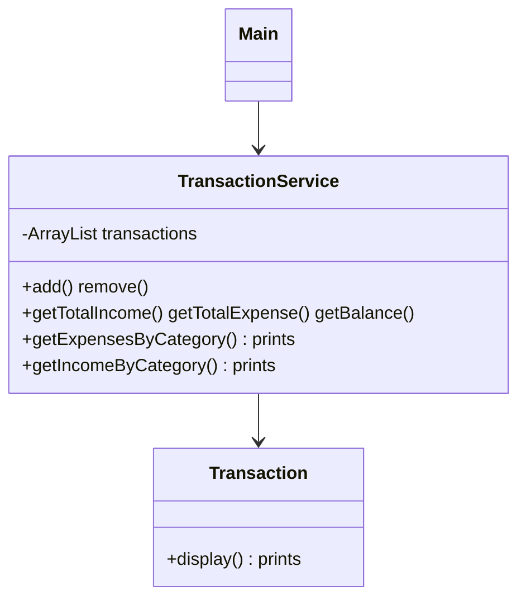
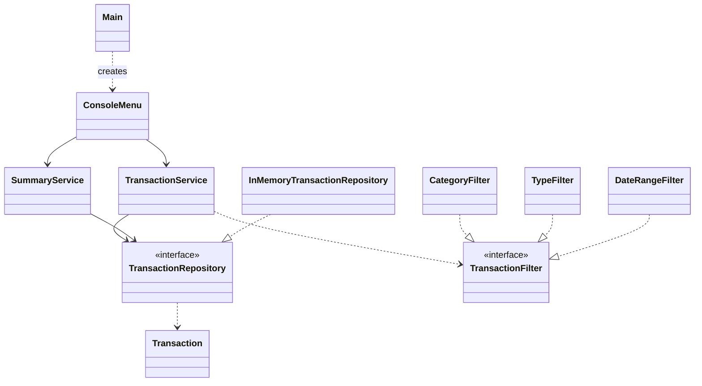

# Lab 1 - TMPS

Vasile Brînză, gr. FAF-242

Console app for tracking income and expenses: add, delete, history, total income,
total expenses, balance, expenses by category, and filters. I refactored it from a
3-class program to apply 3 SOLID principles.

## Chosen principles

| Principle | Why |
|-----------|-----|
| **SRP** (Single Responsibility) | `TransactionService` stored data, did calculations and printed to the console. |
| **OCP** (Open/Closed) | Every new way of searching meant a new method in the service. |
| **DIP** (Dependency Inversion) | The service created its own `ArrayList`, so it was tied to one kind of storage. |


## Implementation

Each principle below has the same 3 parts: the problem in the old code, the solution, and the result.

### 1. SRP: one class, one job

Before: `TransactionService` had three jobs: storing transactions, calculating
totals, and printing to the console. `Transaction` also printed itself with `display()`.

```java
// old TransactionService
public double getExpensesByCategory(String Category){
    double expense = 0;
    for (Transaction t : transactions) { ... }                                   // calculation
    System.out.println("Expenses by Category: " + Category + " = " + expense);   // printing
    return expense;
}
```

After implementing SRP: Every job has its own class:

| Class | Its only job |
|-------|--------------|
| `Transaction` | hold and validate the data |
| `TransactionService` | add, delete, list, filter transactions |
| `SummaryService` | total income, total expenses, balance, expenses by category |
| `ConsoleMenu` | read input and print output |

```java
// SummaryService: returns the data, does not print
public Map<String, Double> getExpensesByCategory() { ... }
 
// ConsoleMenu: decides how to show it
for (Map.Entry<String, Double> entry : byCategory.entrySet()) {
    System.out.printf("  %-15s %.2f%n", entry.getKey(), entry.getValue());
}
```

SRP makes it viable so that if the output format changes, only `ConsoleMenu` changes. If a calculation
changes, only `SummaryService` changes.

### 2. OCP: add features without editing old code

Before: every new way of searching needed a new method inside the service:
`getExpensesByCategory(...)`, `getIncomeByCategory(...)`, and a date or type search would
mean even more methods.

After: One interface describes a rule: "does this transaction match?"

```java
public interface TransactionFilter {
    boolean matches(Transaction transaction);
}
```

Each filter is a small class that implements it:

```java
public class CategoryFilter implements TransactionFilter {
    private final String category;
 
    public CategoryFilter(String category) {
        this.category = category.trim();
    }
 
    @Override
    public boolean matches(Transaction transaction) {
        return transaction.getCategory().equalsIgnoreCase(category);
    }
}
```

`TypeFilter` and `DateRangeFilter` work the same way. The service has **one** method that
accepts any of them:

```java
public List<Transaction> filter(TransactionFilter filter) {
    List<Transaction> result = new ArrayList<>();
    for (Transaction t : repository.findAll()) {
        if (filter.matches(t)) {
            result.add(t);
        }
    }
    return result;
}
 
// usage
transactionService.filter(new CategoryFilter("food"));
```

Thus, to add "filter by amount" I only write `AmountFilter implements TransactionFilter`.
`TransactionService` is not edited: open for extension, closed for modification.

### 3. DIP: depend on abstractions, not on details

High-level modules should not depend on low-level modules. Both should
depend on abstractions. Abstractions should not depend on details; details should depend
on abstractions.


**In our project**

| In the principle | In our project |
|------------------|----------------|
| High-level module | `TransactionService` (the logic: add, delete, filter) |
| Low-level module (detail) | the list that holds the transactions (`ArrayList`) |
| Abstraction | `TransactionRepository` (an interface) |

Before = The high-level class names the low-level detail directly:

```java
// TransactionService
private ArrayList<Transaction> transactions = new ArrayList<>();
```

After = An interface sits in the middle, and both sides depend on it:

```java
// the abstraction
public interface TransactionRepository {
    void add(Transaction transaction);
    void remove(int index);
    List<Transaction> findAll();
}
 
// low-level: follows the interface
public class InMemoryTransactionRepository implements TransactionRepository { ... }
 
// high-level: only knows the interface
public TransactionService(TransactionRepository repository) {
    this.repository = repository;
}
```


`Main` creates the real class and passes it in, so the services never name it:

```java
TransactionRepository repository = new InMemoryTransactionRepository();
TransactionService transactionService = new TransactionService(repository);
SummaryService summaryService = new SummaryService(repository);
```

The logic does not depend on how the list is implemented. If the low-level
part changes (for example, saving to a file), I write a new class that implements
`TransactionRepository` and change one line in `Main`. `TransactionService` stays the
same. (Right now there is only one implementation.)

## Bonus: diagrams

Before:



After:



<!-- TODO: add a screenshot of the refactoring (git diff or IDE before/after) here -->
